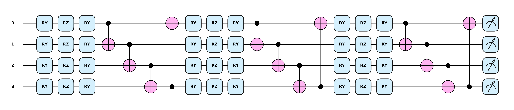
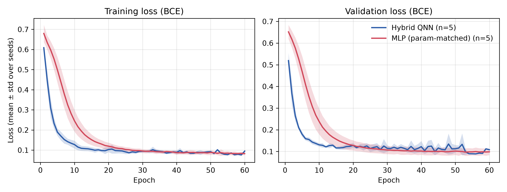
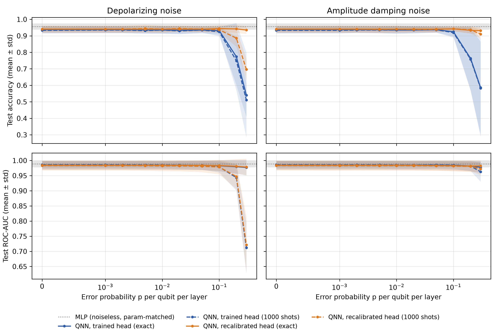
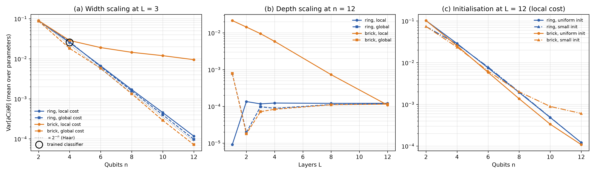

# Hybrid Quantum Neural Networks under NISQ Constraints: Noise Robustness, Readout Recalibration, and Entangler-Dependent Barren Plateaus

**Uhenraj Jarga Magar**

A reproducible benchmark of a data re-uploading variational quantum classifier against parameter-matched classical baselines. We evaluate the classifier under simulated hardware noise and finite measurement shots, and analyse how gradient variance (trainability) scales with qubit count, depth, cost locality, entangler topology and initialisation.


*Figure 1. The trained classifier: 4 qubits, 3 data re-uploading layers. Each layer applies an RY(x) encoding, trainable RZ·RY rotations and a ring of CNOTs. Readout is ⟨Z_i⟩ on every qubit followed by a 5-parameter linear head.*

---

## Abstract

Variational quantum classifiers are often reported against weak or unmatched baselines, on noiseless simulators, with single-seed results. We instead benchmark a 29-parameter hybrid quantum neural network (QNN) against a 31-parameter MLP and a logistic regression on the Wisconsin breast-cancer dataset. All models use identical leakage-free preprocessing, and we report mean ± std over five seeds.

The QNN reaches **0.937 ± 0.020** test accuracy, statistically comparable to but not better than the MLP (0.956 ± 0.019) and logistic regression (0.951 ± 0.019). We make **no claim of quantum advantage**.

We then ask two NISQ-relevant questions.

1. **How does a noiselessly trained circuit degrade under noise?** Accuracy is flat up to an effective error rate of p ≈ 0.1 per qubit per layer and then collapses (0.540 ± 0.258 at p = 0.3, depolarizing). With exact expectation values, ROC-AUC stays near 0.98, so the collapse is a miscalibrated readout rather than lost information. Refitting only the 5-parameter linear head restores accuracy to 0.935. With 1 000 shots, however, recovery is only partial (0.696), because depolarizing noise shrinks the signal toward the shot-noise floor.
2. **Does the architecture scale?** Using a cost on a single qubit (a local cost) is the standard way to avoid barren plateaus. It **does not help** with the sequential ring entangler used here: the local-cost gradient variance decays at the Haar-random rate (≈ 2× per qubit) already at depth 3. A brick-layer entangler with the same gate count per qubit keeps the local cost trainable (decay ≈ 1.14× per qubit). At n = 12 and L = 3 its gradient variance is 81× larger.

## Hypotheses

- **H1 (parity, not advantage).** On a low-dimensional, nearly linearly separable tabular task, a small QNN matches but does not beat parameter-matched classical models.
- **H2 (noise robustness).** Shallow re-uploading circuits tolerate realistic NISQ error rates. Most of the degradation at higher noise comes from the noise shrinking ⟨Z⟩, which the classical readout can correct if the shot budget allows.
- **H3 (trainability depends on the entangler).** Whether a local cost avoids barren plateaus depends on the backward light cone set by the entangling layer, not only on the observable.

**Outcome:** H1 and H3 are supported. H2 is supported for exact expectation values and only partially at a 1 000-shot budget (see [Results](#results)).

---

## Methodology

### Notation, for readers from ML

An n-qubit pure state is a unit vector |ψ⟩ ∈ ℂ^(2ⁿ) (the *statevector*). A gate is a unitary matrix, and gates on different qubits combine through tensor (Kronecker) products. A circuit is the product U(x, θ) = U_L ⋯ U_1 applied to |0…0⟩. A model output is an expectation value ⟨ψ|O|ψ⟩ of a Hermitian observable O, here Pauli-Z (eigenvalues ±1), so each output lies in [−1, 1].

Under noise, the state becomes a *density matrix* ρ (a 2ⁿ × 2ⁿ positive semidefinite matrix with trace 1). Noise channels act as ρ ↦ Σ_k K_k ρ K_k† with Kraus matrices satisfying Σ_k K_k† K_k = I.

### Data pipeline (leakage-free)

1. Stratified split into 60 % train, 20 % validation and 20 % test (569 samples, 30 features).
2. `StandardScaler → PCA(4) → MinMaxScaler([0, π])`, **fit on the training split only** and then applied to the validation and test splits. PCA keeps 79.5 % of training variance on average. A unit test asserts that train-only fitting holds.
3. Each seed re-draws the split, the weight initialisation and the mini-batch order, so the reported std reflects data and optimisation variance together.

### Models

| Model | Architecture | Trainable params |
|---|---|---:|
| Hybrid QNN | 3 × [RY(x) encoding → RZ(θ)·RY(θ) per qubit → CNOT ring], readout ⟨Z₀⟩…⟨Z₃⟩ → Linear(4→1) | 24 quantum + 5 classical = **29** |
| MLP | Linear(4→5) → tanh → Linear(5→1) | **31** |
| Logistic regression | Linear(4→1) | 5 |

**Design choices and trade-offs:**

- **Data re-uploading instead of single encoding.** Encoding x once with RY gates makes the model a trigonometric polynomial of degree 1 in each feature, whatever the depth. Re-encoding x in each of L layers raises the available Fourier frequencies to L (Schuld et al., 2021). This costs n extra single-qubit gates per layer and no extra parameters.
- **Hardware-efficient RZ·RY layer instead of `StronglyEntanglingLayers`.** It uses 2nL parameters instead of 3nL. It needs only nearest-neighbour CNOTs, so no SWAPs on linear or ring hardware, whereas `StronglyEntanglingLayers` has range-r CNOTs. Every gate is native on superconducting devices. The `sel` ansatz remains available for comparison (`--ansatz sel`).
- **Local readout** (⟨Z_i⟩ per qubit) rather than a global parity observable, because global observables provably produce barren plateaus at any depth (Cerezo et al., 2021). Section [R3](#r3-trainability-barren-plateaus) shows that this choice alone is not sufficient.
- **The linear head is counted** in the QNN's parameter budget, so the comparison is fair.

### Training

Adam with mini-batches of 32, BCE-with-logits loss, at most 60 epochs, and early stopping on validation loss (patience 15, best weights restored). The test split is touched exactly once, after training. QNN gradients are exact (backpropagation through the statevector simulator). Everything runs in float64 with seeds 42–46.

### Noise model

After every layer, each qubit passes through one channel with strength p:

- **Depolarizing:** K = {√(1−p) I, √(p/3) X, √(p/3) Y, √(p/3) Z}. Models generic gate error. To first order it multiplies each single-qubit Pauli expectation by (1 − 4p/3).
- **Amplitude damping:** |1⟩ → |0⟩ with probability p. Models T₁ energy relaxation.

p is an *effective per-layer, per-qubit* error rate, not a calibrated per-gate device model.

### Readout recalibration

The circuit stays fixed, and only the linear head is refit (logistic regression, C = 10⁴) on quantum features measured *under the same noise* on the **training** split. This mirrors running a calibration set on the target device. It is a cheap classical post-processing step related to readout error mitigation.

### Gradient-variance analysis

For each configuration of (n, L, entangler, initialisation), we draw 300 random (θ, x) pairs, compute exact gradients of a local cost (C = ⟨Z₀⟩) and a global cost (C = ⟨Z₀Z₁⋯Z_{n−1}⟩), and report the variance of ∂C/∂θ_k averaged over parameters. All 300 circuits are simulated in a single broadcast pass. Because the draws share no parameters, ∂(Σ_b C_b)/∂θ_b = ∂C_b/∂θ_b, and a unit test checks this against one-at-a-time evaluation. The decay factor b is fit as Var ∝ b^(−n) over n ∈ {4, …, 12}. Haar-random states give b ≈ 2.

Two entanglers are compared, both with nearest-neighbour CNOTs:

- **Ring:** (0,1), (1,2), …, (n−1, 0), applied *sequentially*. Each layer therefore has causal depth n, and ⟨Z₀⟩ depends on every qubit after one layer.
- **Brick:** (0,1), (2,3), … then (1,2), (3,4), …, applied as two parallel sub-layers. The light cone of ⟨Z₀⟩ grows by at most two qubits per layer, which a unit test verifies.

---

## Experimental Setup

| | |
|---|---|
| Dataset | sklearn Wisconsin Breast Cancer (569 × 30, binary, 62.7 % benign) |
| Qubits / layers | 4 / 3 (classifier); 2–12 / 1–12 (gradient-variance grid) |
| Seeds | 42, 43, 44, 45, 46 (classifier); 42 (gradient-variance grid, 300 draws per configuration) |
| Simulators | PennyLane `default.qubit` (statevector), `default.mixed` (density matrix) |
| Noise grid | p ∈ {0, 0.001, 0.002, 0.005, 0.01, 0.02, 0.05, 0.1, 0.2, 0.3} × {depolarizing, amplitude damping} × {exact, 1 000 shots} |
| Software | Python 3.12.14, PennyLane 0.45.1, PyTorch 2.15.0 (CPU), scikit-learn 1.9.1; exact versions in `requirements-lock.txt` |
| Compute | Single laptop CPU. Baseline ≈ 1 min, noise sweep ≈ 1 min, gradient-variance grid ≈ 3 min |

---

## Results

### R1. Noiseless benchmark

Test-set metrics, mean ± std over 5 seeds:

| Model | Params | Accuracy | Balanced acc. | F1 | ROC-AUC |
|---|---:|---|---|---|---|
| Hybrid QNN | 29 | 0.937 ± 0.020 | 0.931 ± 0.031 | 0.950 ± 0.014 | 0.985 ± 0.014 |
| MLP (param-matched) | 31 | 0.956 ± 0.019 | 0.950 ± 0.027 | 0.966 ± 0.014 | 0.988 ± 0.011 |
| Logistic regression | 5 | 0.951 ± 0.019 | 0.941 ± 0.028 | 0.962 ± 0.014 | 0.987 ± 0.012 |


*Figure 2. Training and validation loss, mean ± std over 5 seeds.*

All three models fall within about one standard deviation of each other. Logistic regression, with 5 parameters, matches both nonlinear models, which indicates that the 4-component PCA representation is close to linearly separable. **This task cannot tell the models' expressivity apart**, so we treat the noiseless benchmark as a sanity check, not as evidence for or against the QNN.

The QNN reaches its minimum validation loss within about 10 epochs, against about 40 for the MLP. However, the two models were trained with different learning rates (0.05 vs. 0.01), so we do not claim faster convergence (see [Limitations](#limitations)).

### R2. Noise robustness and readout recalibration


*Figure 3. Test accuracy (top) and ROC-AUC (bottom) of the noiselessly trained QNN as a function of the per-layer error probability. Solid lines use exact expectation values and dashed lines use 1 000 shots. The grey band is the noiseless MLP, mean ± std.*

Test accuracy, mean ± std over 5 seeds (full table in `results/noise_sweep_breast_cancer_reupload_hea.csv`):

| Channel | p | Trained head (exact) | Recalibrated (exact) | Trained head (1 000 shots) | Recalibrated (1 000 shots) |
|---|---:|---|---|---|---|
| Depolarizing | 0.01 | 0.935 ± 0.023 | 0.940 ± 0.018 | 0.935 ± 0.020 | 0.940 ± 0.022 |
| | 0.1 | 0.932 ± 0.024 | 0.944 ± 0.020 | 0.925 ± 0.027 | 0.937 ± 0.017 |
| | 0.2 | 0.774 ± 0.203 | 0.942 ± 0.024 | 0.749 ± 0.148 | 0.886 ± 0.052 |
| | 0.3 | 0.540 ± 0.258 | 0.935 ± 0.024 | 0.511 ± 0.103 | 0.696 ± 0.067 |
| Amplitude damping | 0.1 | 0.925 ± 0.028 | 0.942 ± 0.015 | 0.919 ± 0.030 | 0.942 ± 0.013 |
| | 0.2 | 0.763 ± 0.193 | 0.933 ± 0.019 | 0.758 ± 0.190 | 0.937 ± 0.022 |
| | 0.3 | 0.586 ± 0.298 | 0.932 ± 0.021 | 0.582 ± 0.282 | 0.911 ± 0.026 |

**Observations:**

1. **There is a wide robust regime.** Accuracy is unchanged within noise up to p ≈ 0.1 per qubit per layer for both channels. For orientation, current superconducting devices have two-qubit gate errors of roughly 0.3–1 %, so this circuit's effective per-layer error sits well inside that regime. This conclusion is specific to a 4-qubit, 3-layer circuit.
2. **The collapse is a calibration failure, not lost information.** With exact expectation values at p = 0.3 (depolarizing), the *trained* head's ROC-AUC is still 0.977, even though accuracy drops to 0.540. Noise shrinks every ⟨Z_i⟩ toward 0, roughly by (1 − 4p/3)^L ≈ 0.22 here, which keeps the ranking of samples but leaves the learned decision threshold in the wrong place. Refitting 5 classical parameters restores accuracy to 0.935.
3. **Finite shots limit the fix.** At 1 000 shots, each ⟨Z_i⟩ estimate has standard error up to 1/√1000 ≈ 0.03, comparable to the shrunken signal. ROC-AUC itself falls to 0.712 at p = 0.3, so information really is lost, and recalibration only reaches 0.696. Amplitude damping is *not* unital (it drives qubits toward |0⟩ rather than toward the maximally mixed state), so it shrinks ⟨Z⟩ less, and recovery at 1 000 shots stays at 0.911.

The practical takeaway is that the shot budget needed for a given accuracy grows as the noise shrinks the signal, roughly as 1/(shrink factor)². Simulations with exact expectation values hide this cost.

### R3. Trainability: barren plateaus


*Figure 4. Variance of the cost gradient, averaged over parameters. (a) Scaling with qubit count at the classifier's depth L = 3; the circled point is the trained classifier. (b) Scaling with depth at n = 12. (c) Effect of initialisation at L = 12, local cost.*

Fitted per-qubit decay factor b (Var ∝ b^(−n), n = 4…12, uniform initialisation; all R² ≥ 0.97):

| Entangler | Cost | L = 3 | L = 12 |
|---|---|---:|---:|
| Ring (used by the classifier) | Local ⟨Z₀⟩ | 1.96 | 1.98 |
| Ring | Global ⟨Z^⊗n⟩ | 2.01 | 1.99 |
| Brick | Local ⟨Z₀⟩ | **1.14** | 1.99 |
| Brick | Global ⟨Z^⊗n⟩ | 2.02 | 1.99 |

**Observations:**

1. **Global costs plateau at every depth tested**, at the Haar rate b ≈ 2, which reproduces Cerezo et al. (2021).
2. **With the ring entangler, a local cost is not enough.** Its local-cost variance decays as fast as the global cost's, already at L = 3. The sequential CNOT ring spreads the backward light cone of Z₀ over all n qubits within one layer, so the "local" observable behaves like a global one.
3. **A brick entangler restores trainability at shallow depth.** At n = 12, its local-cost variance is about 2 400× the ring's at L = 1 and 81× at L = 3. For the first-layer parameter on qubit 0, which lies inside the light cone, the gap at L = 3 is about 540×. The protection disappears once L is about n (panel b), as theory predicts.
4. **Small initialisation barely helps** (panel c; b ≈ 1.98 for the ring with either initialisation). Near-zero weights make the trainable gates close to the identity, but the re-uploaded RY(x) data gates still apply arbitrary rotations, so the circuit is not near the identity. Mitigations designed for circuits without data encoding do not carry over directly to re-uploading models.
5. **The trained classifier is in a trainable regime** (n = 4, Var ≈ 2.6 × 10⁻²). Scaled to more qubits with the ring entangler, however, it would plateau. The brick entangler is the scalable design.

---

## Discussion

The three experiments give a consistent picture of what matters for this model class on NISQ hardware.

- **Accuracy is not the bottleneck.** At this scale the QNN matches classical models, and the task cannot tell them apart.
- **Under noise, the classical readout and the shot budget matter more than the circuit.** Most of the noise-induced error can be removed with 5 classical parameters, until the signal falls to the shot-noise floor.
- **The entangler's topology, not just the choice of observable, decides whether the architecture scales.** This links variational QML design to compilation and hardware layout: two entanglers with the same CNOT count can differ by orders of magnitude in trainability.

---

## Limitations

- **Task difficulty.** Logistic regression matches every model, so R1 cannot test expressivity. Datasets with known nonlinear or quantum-native structure are needed.
- **Hyperparameters.** The QNN and MLP use fixed, different learning rates (0.05 / 0.01) without tuning on the validation split, and the MLP's best epoch was often near the 60-epoch cap (53–59). Convergence-speed comparisons are therefore not claimed.
- **Noise model.** The noise is a per-layer effective channel, not a calibrated per-gate device model. There is no readout error, crosstalk or coherent error.
- **Shots.** Shots are used only at evaluation time. Training uses exact gradients, while on hardware the parameter-shift gradients would themselves be estimated from shots.
- **Scale.** The classifier has 4 qubits. The gradient-variance study reaches 12 qubits, enough to fit decay rates but small in absolute terms.
- **Statistics.** Five seeds give coarse confidence intervals. No significance tests are reported because most differences are within one standard deviation.
- **Gradient-variance metric.** It averages over all parameters, including those outside the light cone (which have exactly zero gradient). This understates the brick entangler's advantage. Per-parameter values (`var_first`, `var_last`) are in `results/barren_plateau.csv`.

## Future Work

1. **Retrain the classifier with the brick entangler** to test whether it keeps accuracy while gaining scalability (`entangler="brick"` is already implemented).
2. **Train under noise** in `default.mixed`, and train with shot-based parameter-shift gradients, then compare with post-hoc recalibration.
3. **Use calibrated device noise models** (e.g. Qiskit fake backends) and add zero-noise extrapolation alongside readout recalibration.
4. **Use harder datasets** with structure where expressivity differences can show.
5. **Run a learning-rate grid per model** selected on the validation split, with more seeds and paired significance tests.
6. **Run a secondary experiment on AI-assisted QEC decoding:** neural decoders vs. minimum-weight perfect matching on Stim-generated surface-code syndromes.

---

## Reproducing

```bash
# Python 3.11+ (tested on 3.12)
python -m venv .venv
# Windows: .venv\Scripts\activate    Linux/macOS: source .venv/bin/activate
pip install -r requirements-lock.txt   # exact versions; or requirements.txt for lower bounds

pytest -q                                   # 15 tests, ~20 s
python -m experiments.run_baseline          # R1: results/, assets/learning_curves.png, assets/circuit_architecture.png
python -m experiments.run_noise_sweep       # R2: needs the baseline checkpoints
python -m experiments.run_barren_plateau    # R3: ~3 min
```

Every script accepts `--quick` for a smoke test and `--help` for options. All randomness is seeded, and computation runs in float64.

## Repository Structure

```
├── src/
│   ├── config.py        # float64 + seeding, ExperimentConfig
│   ├── data.py          # leakage-free split → scaler → PCA → angle scaling
│   ├── circuits.py      # ansätze (re-upload HEA with ring or brick entangler, SEL), QNode factory, finite shots
│   ├── noise.py         # depolarizing / amplitude-damping channels
│   ├── models.py        # HybridQNN, ClassicalMLP, parameter matching
│   ├── train.py         # Adam + early stopping on validation loss
│   ├── evaluate.py      # metrics, aggregation, noise sweep, readout recalibration
│   ├── landscape.py     # broadcast gradient-variance estimation, decay fits
│   └── plotting.py      # 300-DPI figures
├── experiments/         # run_baseline.py, run_noise_sweep.py, run_barren_plateau.py
├── tests/test_core.py   # leakage, dtype, parameter matching, noise sanity, shot reproducibility, light cone
├── assets/              # generated figures
└── results/             # generated metrics (CSV/JSON); checkpoints/ is gitignored
```

## License

MIT. See [LICENSE](LICENSE).

## References

- M. Cerezo, A. Sone, T. Volkoff, L. Cincio, P. J. Coles. *Cost function dependent barren plateaus in shallow parametrized quantum circuits.* Nature Communications 12, 1791 (2021).
- J. R. McClean, S. Boixo, V. N. Smelyanskiy, R. Babbush, H. Neven. *Barren plateaus in quantum neural network training landscapes.* Nature Communications 9, 4812 (2018).
- M. Schuld, R. Sweke, J. J. Meyer. *Effect of data encoding on the expressive power of variational quantum machine-learning models.* Physical Review A 103, 032430 (2021).
- A. Pérez-Salinas, A. Cervera-Lierta, E. Gil-Fuster, J. I. Latorre. *Data re-uploading for a universal quantum classifier.* Quantum 4, 226 (2020).
- E. Grant, L. Wossnig, M. Ostaszewski, M. Benedetti. *An initialization strategy for addressing barren plateaus in parametrized quantum circuits.* Quantum 3, 214 (2019).
- S. Wang et al. *Noise-induced barren plateaus in variational quantum algorithms.* Nature Communications 12, 6961 (2021).
- V. Bergholm et al. *PennyLane: Automatic differentiation of hybrid quantum-classical computations.* arXiv:1811.04968 (2018).
